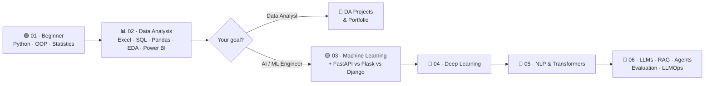

# AI Roadmap 2027

### A structured, project-driven path from zero to production AI: Beginner → Data Analysis → Machine Learning → Deep Learning → NLP → LLMs

> **Approach:** learn the concept, implement it, explain your decisions, and publish the result.
> Every stage pairs **Arabic 🇪🇬** and **English 🇬🇧** resources. Pick **one primary resource** per topic and use the other only when a concept isn't clear.

------------------------------------------------------------------------

## 🗺️ The Route



## 📚 Levels

| Level | Folder | Main focus | Duration* | Exit project |
|:--|:--|:--|--:|:--|
| 🟢 **Beginner** | [`01-beginner`](01-beginner/README.md) | Python, OOP, Statistics & Probability | 6–8 weeks | CSV summary tool |
| 📊 **Beginner → Data Analysis** | [`02-data-analysis`](02-data-analysis/README.md) | Excel, Power Query, SQL (PostgreSQL), Python for Data Analysis, Power BI, DAX, Thinking sessions | 12 weeks | DA portfolio projects |
| 🟡 **Intermediate** | [`03-machine-learning`](03-machine-learning/README.md) | Math for ML, supervised, unsupervised, ensembles, intro to neural networks, **FastAPI vs Flask vs Django** | 8 weeks | ML model served through an API |
| 🔴 **Advanced** | [`04-deep-learning`](04-deep-learning/README.md) | ANN training, CNN, transfer learning, XAI, autoencoders, GANs, RNN/LSTM | 6 weeks | Transfer-learning image classifier |
| 🔴 **Advanced** | [`05-nlp-transformers`](05-nlp-transformers/README.md) | Classical NLP, embeddings, attention, Transformers, Hugging Face | 5 weeks | Fine-tuned text classifier |
| 🔴 **Advanced** | [`06-llm-engineering`](06-llm-engineering/README.md) | 5 phases: LLM foundations → RAG & context engineering → agents → evaluation → production (LLMOps) | 20 weeks | A shipped, evaluated LLM application |

\* At ~10 hrs/week. Every level has a **📅 weekly plan** at the top of its README. Durations are estimates, not deadlines. Move on when you can **apply** the skills, not merely when you finish a playlist.

| Track | Path | Total |
|:--|:--|--:|
| 📊 **Data Analyst** | Beginner (6–8) → Data Analysis (12) | **~18–20 weeks (~4.5 months)** |
| 🤖 **AI / ML Engineer** | Beginner (6–8) → Data Analysis, AI weeks only (7) → ML (8) → DL (6) → NLP (5) → LLMs (20) | **~52–54 weeks (~1 year)** |

### Which parts of Data Analysis do AI learners need?

| Topic in `02-data-analysis` | Data Analyst track | AI / ML track |
|:--|:--:|:--:|
| Python for Data Analysis (NumPy, Pandas, cleaning, RegEx, visualization, EDA) · weeks 6–9 | ✅ Required | ✅ Required |
| SQL (PostgreSQL) · weeks 3–5 | ✅ Required | ✅ Required |
| Thinking sessions | ✅ Required | ⭐ Recommended |
| Excel & Power Query, Power BI, DAX | ✅ Required | ➖ Optional |
| Web scraping | ➖ Optional | ➖ Optional |

------------------------------------------------------------------------

## 🗂️ Repository Structure

```text
ai-roadmap-2027/
├── README.md                      ← you are here (overview)
├── 01-beginner/README.md          ← Python, OOP, Statistics & Probability
├── 02-data-analysis/
│   ├── README.md                  ← tool sessions + thinking sessions
│   └── assets/data-analyst-roadmap.png
├── 03-machine-learning/README.md  ← ML + FastAPI vs Flask vs Django
├── 04-deep-learning/README.md
├── 05-nlp-transformers/README.md
├── 06-llm-engineering/README.md   ← 5 phases: Foundations → RAG → Agents → Evaluation → Production
└── RESOURCES.md                   ← all main courses, books and channels in one place
```

------------------------------------------------------------------------

## ✅ How to Use This Roadmap

1. **Follow the sequence.** Later stages assume the skills from earlier ones.
2. **Choose one primary resource per topic.** Use alternatives only when you need another explanation.
3. **Practice every week.** Reproduce examples, solve small exercises, and work with unfamiliar datasets.
4. **Build projects as you learn.** Don't postpone all practical work until the end.
5. **Keep evidence of your skills.** Publish clean GitHub repositories with clear READMEs, setup instructions, results, and limitations.
6. **Review by implementing**, not by rewatching the same videos.

> **About video numbers:** when this roadmap says *"Ahmed Yousry #20"* or *"Hesham Asem #4"*, the number is the video's **position in the playlist**, and every number is a direct link to that video.

------------------------------------------------------------------------

## 🙏 Credits

- Beginner and Data Analysis levels are based on the **Data Analyst Roadmap** and the **Data Science & AI Roadmap 2027**, prepared by our colleagues.
- Level 6 follows the layered LLM route: Foundations → LLM Engineering → Agents → Evaluation → Production.
- All links were checked on **November 2026**. If a link breaks, please open an issue or a pull request.
